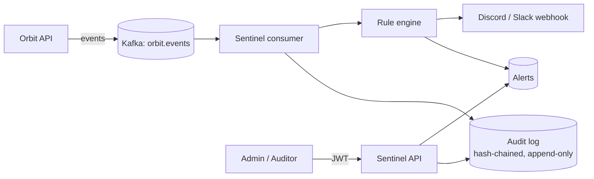

# Orbit Sentinel: Security Event Monitor

A service that watches the events produced by other systems, keeps a **tamper-evident audit trail**,
and raises alerts when activity looks suspicious.

## The problem
Every organisation needs to answer "who did what, and when?" and to notice when something looks wrong,
such as repeated failed logins or an unexpected role change. Many breaches are found late because nobody
was watching the logs. Sentinel turns raw events into an audit trail and real-time alerts.

## Architecture

## Tech stack
- Java 21, Spring Boot
- Apache Kafka (event ingestion)
- PostgreSQL (audit log and alerts), Flyway migrations
- JWT authentication with role-based access
- Docker Compose

## Detection rules
| Rule | Trigger | Severity |
|---|---|---|
| `FAILED_LOGIN_BURST` | 5 failed logins for one account within 2 minutes | HIGH |
| `AFTER_HOURS_LOGIN` | Successful login between 22:00 and 05:00 (Africa/Johannesburg) | MEDIUM |
| `ROLE_CHANGED` | Any role change | HIGH |

Thresholds live in `application.yml`. To add a rule, implement `DetectionRule` and annotate it with `@Component`.

## How the audit trail is protected
- **Append-only:** a database trigger rejects every `UPDATE` and `DELETE` on `audit_events`, and the entity has no setters.
- **Hash chain:** each record stores the hash of the previous one plus its own SHA-256 over its content.
  `GET /api/audit-events/verify` recomputes the whole chain and reports the first record that does not match.
- **Idempotent:** the unique `event_id` makes Kafka redelivery harmless.

## Access control
Sentinel verifies the JWTs issued by [orbit-graduate-system](https://github.com/vanessa-botsime/orbit-graduate-system).

| Role | Access |
|---|---|
| `ADMIN` | Read audit log and alerts, verify the chain |
| `AUDITOR` | Read-only access to audit log and alerts |
| `USER` | None |

## API
| Method | Path | Role |
|---|---|---|
| GET | `/api/audit-events?type=&actor=&page=&size=` | ADMIN, AUDITOR |
| GET | `/api/audit-events/verify` | ADMIN |
| GET | `/api/alerts` | ADMIN, AUDITOR |

## Running locally
1. Start Orbit's stack first (it provides Kafka on `localhost:9092`) and run Orbit.
2. `cp .env.example .env`, then set `DB_PASSWORD` and set `JWT_SECRET` to the **same** value Orbit uses.
3. `docker compose --env-file .env up -d`  (Sentinel's own Postgres on port 5433)
4. `./mvnw spring-boot:run`  (API on port 8081)
5. Optional: put a Discord or Slack webhook URL in `ALERT_WEBHOOK_URL`. Without one, alerts are only logged.
6. Run `scripts/demo.sh` to generate failed logins and application activity, then read `/api/alerts`.

## Security notes
- Webhook messages and logs strip control characters and break `@mentions`, because actor names come from user input
- Secrets are read from environment variables and `.env` is git-ignored
- Parameterised queries only (Spring Data JPA)
- Sentinel and Orbit share an HMAC secret for simplicity. A production setup would use an identity provider
  with asymmetric keys (for example OIDC), so Sentinel only needs the public key.

## Known limitations
- No dashboard yet (API only)
- Tokens stay valid until they expire, even after a role change
- The audit chain is verified on demand, not continuously

## Status
In progress. Built as a companion to orbit-graduate-system.
